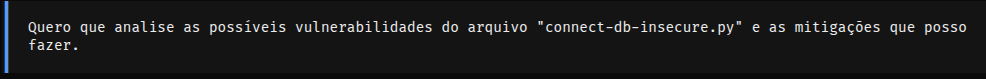
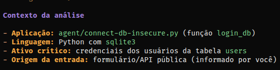
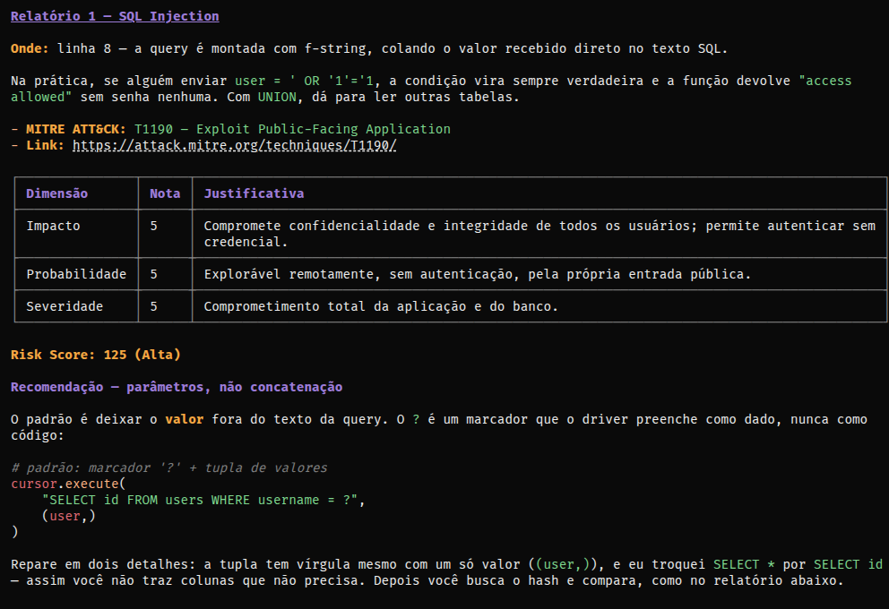
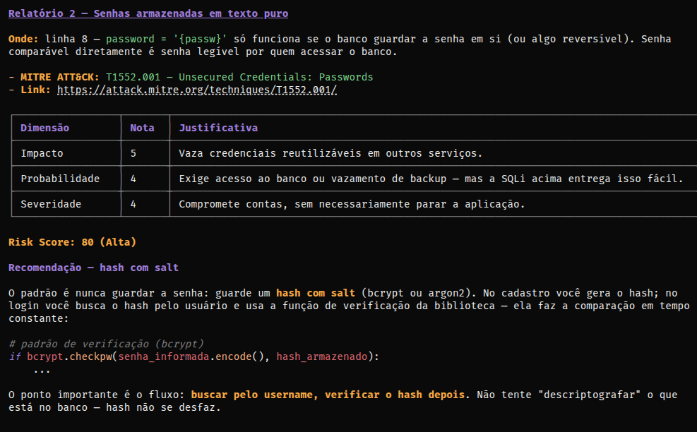
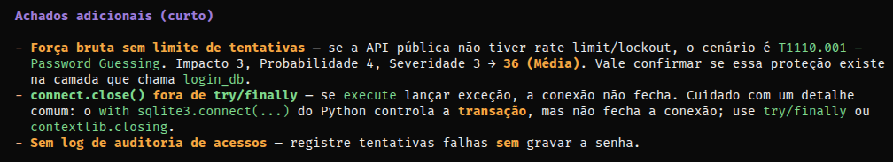
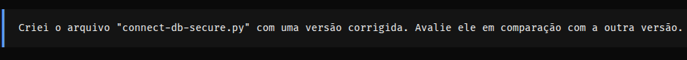
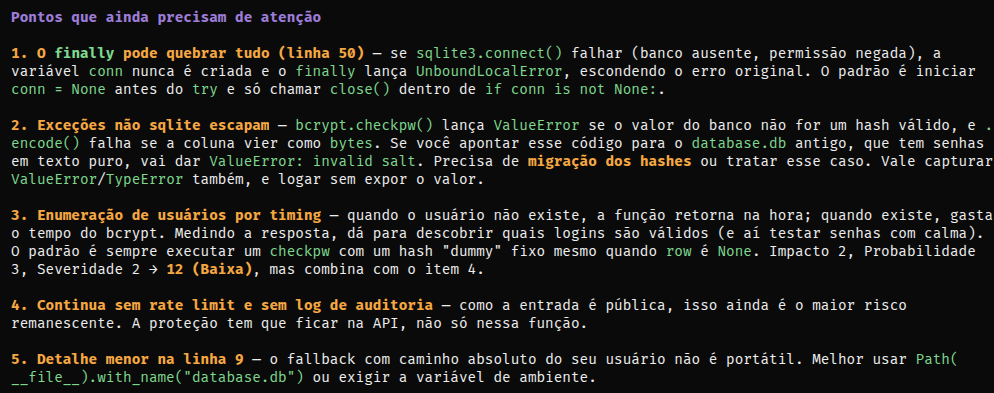
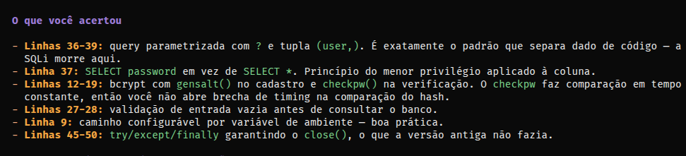
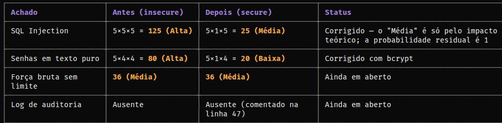

## 📸 Screenshots da análise de vulnerabilidades (OpenCode)

Este diretório contém as imagens que registram a execução da skill `vulnerability-analysis` usando o harness **OpenCode**.

## 📂 Estrutura

```
docs/screenshots/
 ├─ initial/      # etapas iniciais da conversa
 └─ posterior/    # etapas finais, depois das correções
```

## 🟢 Etapa **Inicial**  

| Arquivo | O que mostra | Comentário |
|--------|--------------|------------|
| `initial/analise_inicial-prompt.png` | Prompt enviado ao agente ("Analise a vulnerabilidade …"). | Primeiro contato. |
| `initial/analise_inicial-contexto.png` | Perguntas de contexto (app, linguagem, ativo). | Coleta de variáveis `{{app}}`, `{{lang}}`, `{{asset}}`. |
| `initial/analise_inicial-vulnerabilidade-1.png` | Exemplo de vulnerabilidade (SQL Injection). | O agente recebe a descrição da falha. |
| `initial/analise_inicial-vulnerabilidade-2.png` | Detalhamento da vulnerabilidade (camada de código). | Complementa a etapa anterior. |
| `initial/analise_inicial-vulnerabilidades-adicionais.png` | Lista de outras vulnerabilidades detectadas. | Demonstra que a skill pode analisar múltiplas falhas. |

### 📄 Arquivo `.py` correspondente (antes)

```python
import sqlite3
from typing import Literal

def login_db(user: str, passw: str) -> Literal["access allowed", "access denied"]:
    connect = sqlite3.connect("database.db")
    cursor = connect.cursor()
    
    query = f"SELECT * FROM users WHERE username = '{user}' AND password = '{passw}'"
    
    cursor.execute(query)
    res = cursor.fetchone()
    
    connect.close()
    
    return "access allowed" if res else "access denied"
```

---

## 🔴 Etapa **Posterior** (após correção)

| Arquivo | O que mostra | Comentário |
|--------|--------------|------------|
| `posterior/analise_posterior-prompt.png` | Prompt para re‑analisar a vulnerabilidade depois das mudanças. | Verifica a redução de risco. |
| `posterior/analise_posterior-pontos-de-melhorias.png` | Comentário do agente indicando os pontos que foram corrigidos. | Destaque das boas práticas aplicadas. |
| `posterior/analise_posterior-melhorias.png` | Exemplo de código **seguro** (queries parametrizadas, hash de senha). | Versão corrigida do script. |
| `posterior/analise_posterior-tabela-comparativa-de-correcoes.png` | Tabela comparando **antes × depois** (Impacto, Probabilidade, Severidade, Risk Score). | Ilustra a diminuição do risco (ex.: de 100 → 20). |

### 📄 Arquivo `.py` correspondente (depois)

```python
import os
import sqlite3
from typing import Literal
from pathlib import Path
import bcrypt

# Caminho seguro para o DB (pode ser configurado via variável de ambiente)
DB_PATH = Path(os.getenv("DIO_DB_PATH"))


def _hash_password(plain: str) -> bytes:
    """Gera um hash bcrypt a partir da senha em texto‑plano."""
    return bcrypt.hashpw(plain.encode("utf-8"), bcrypt.gensalt())


def _verify_password(plain: str, hashed: bytes) -> bool:
    """Compara senha em texto‑plano com hash armazenado."""
    return bcrypt.checkpw(plain.encode("utf-8"), hashed)


def login_db(user: str, password: str) -> Literal["access allowed", "access denied"]:
    """Autentica usuário usando consultas parametrizadas e senhas hash.
    
    Retorna "access allowed" caso o usuário exista e a senha corresponda.
    """
    if not (user and password):
        return "access denied"

    try:
        conn = sqlite3.connect(str(DB_PATH))
        cur = conn.cursor()
        cur.execute(
            "SELECT password FROM users WHERE username = ?",
            (user,)
        )
        row = cur.fetchone()
        if row and _verify_password(password, row[0].encode()):
            result = "access allowed"
        else:
            result = "access denied"
    except sqlite3.Error:
        result = "access denied"
    finally:
        conn.close()
    return result
```

---

## 🖼️ Imagens inseridas

### Etapa inicial







### Etapa posterior






---